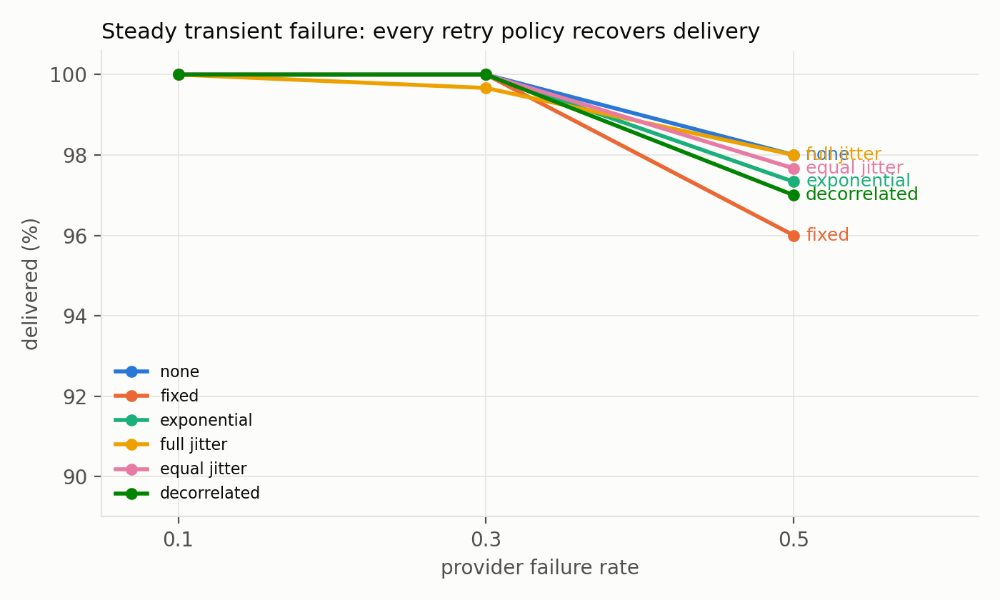
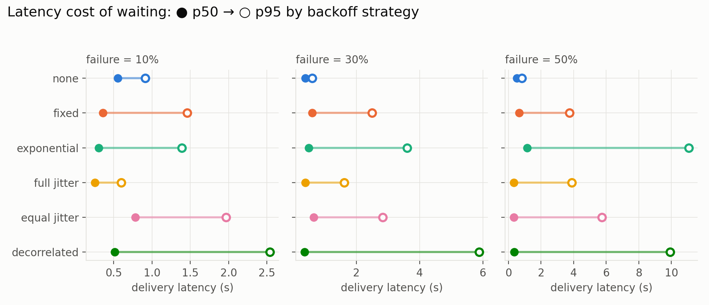
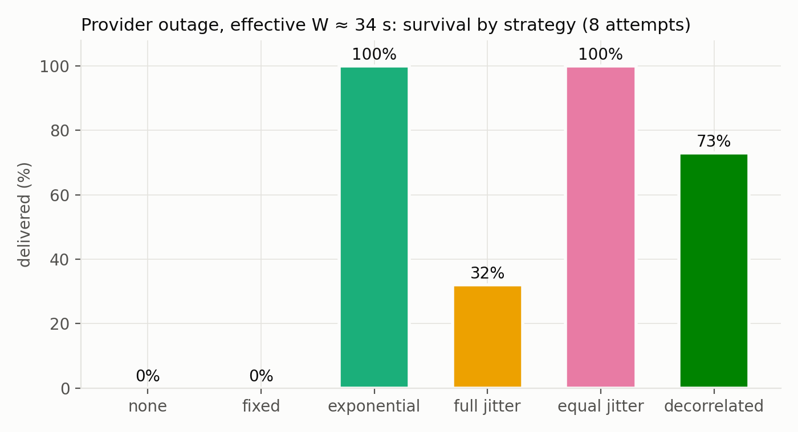
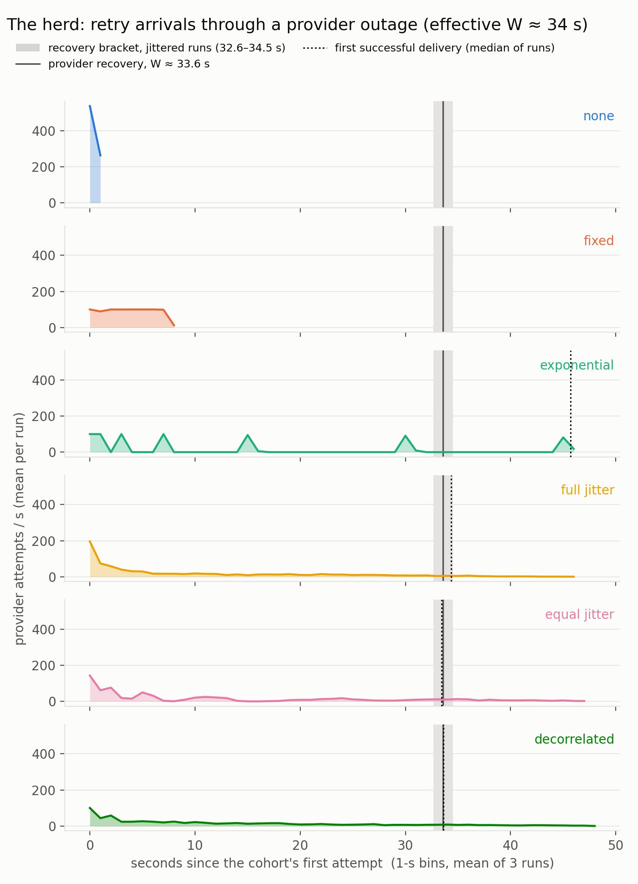
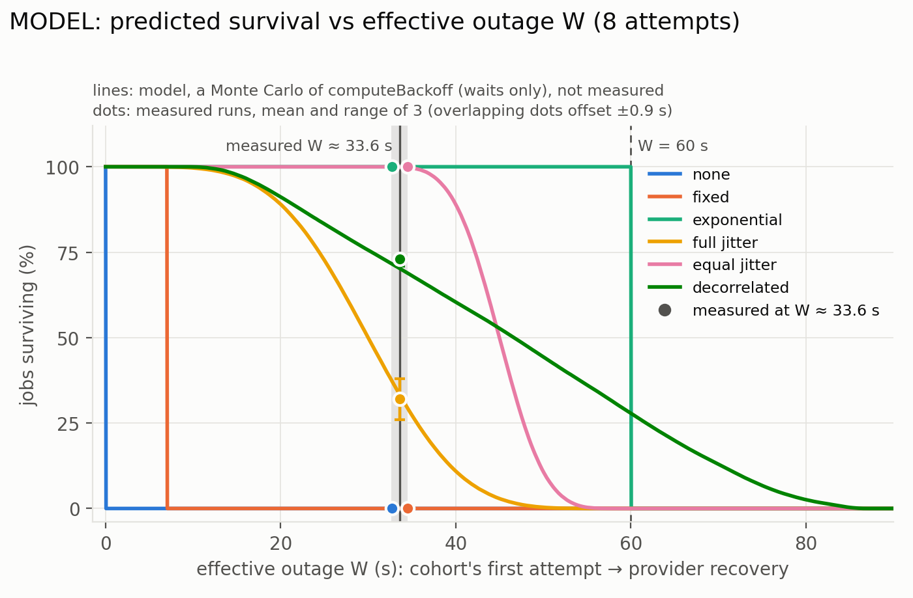

# Retry backoff under failure: a measurement study of a reminder-delivery engine

*Syncin measurement report · August 2026 · Revised October 2026*

> **Revised October 2026.** The outage result is now stated against the outage the
> reminders actually faced (an effective W ≈ 34 s; the first version compared every
> schedule with the configured 60 s). A coverage model (§3.3, fig 5) and references are
> added, equal and decorrelated jitter are credited to Brooker (2015), and every number
> is regenerated by `analyze.py` into `results/derived.json`. Corrected along the way:
> the injection-validity rates, the f = 0.1 cost range, the recovery-load peaks (now with
> a stated definition), and the threats to validity. The 72 runs are unchanged.

## Abstract

We measure how the choice of retry-backoff strategy affects delivery reliability,
latency, and provider load in a queue-based delivery engine, under two failure regimes:
steady per-call transient failure and a provider outage. Six strategies share the same
base and cap (1 s, 15 s) and, within each regime, the same attempt budget: immediate
retry, fixed, exponential, and the full, equal and decorrelated jitter variants as named
and compared by Brooker (2015). Under steady *uncorrelated* failure, strategy choice
barely matters: delivery converges to ≈ 1−fⁿ and cost to ≈ 1/(1−f) calls per delivery
regardless of waits — waiting only adds tail latency (p99 0.85 s for immediate retry vs
15.6–16.9 s for exponential/decorrelated at f = 0.5).
Under a *correlated* outage the strategies separate sharply. The mock provider fails every
call until it has been up for 60 s; the synchronized cohort made its first attempt about
26 s after boot, so it faced an effective outage of **W ≈ 34 s**. With 8 attempts,
immediate and fixed retry deliver **0%** (their schedules exhaust inside the outage), full
jitter **32%**, decorrelated 73%, and exponential and equal jitter **100%**. Survival is
governed by *schedule coverage* — whether the sum of the attempt budget's waits reaches
W — and a Monte Carlo of the engine's own backoff code, given only the measured W,
predicts all six results to within two binomial standard errors. At this outage length,
equal jitter matched exponential's 100% survival with a ~5× smaller recovery peak (mean
18.7 vs 100 attempts in the busiest 1-s window after the first delivery). The same model
says this does not carry over to a true 60 s outage at this budget, where full and equal
jitter would both deliver ≈ 0%. Backoff should be sized as a deadline-coverage problem
first and jittered above a floor second; the second half rests on one measured outage
length.

## 1. System under test

Syncin is a multi-tenant scheduled-delivery engine (Node/Fastify · PostgreSQL/Prisma ·
Redis/BullMQ). Creating an event transactionally persists reminder rows, then enqueues
delayed jobs; a worker (concurrency 5) delivers each due reminder through a provider
interface, retrying failures on a configurable backoff schedule, dead-lettering after a
fixed attempt budget, with a send-idempotency key that skips a reminder whose send is
already recorded (the queue is at-least-once). The provider is an in-process mock with
configurable failure injection: per-call failure probability and transient/permanent split
(random and unseeded, so re-runs reproduce rates, not exact counts), added latency, and a
deterministic "provider outage until uptime T" mode. Every provider attempt is recorded
with a millisecond timestamp and exposed via `/metrics/attempts`; engine state (job
states, failed-attempt counts, dead-letter size) via `/metrics`.

**Strategies measured** (`b` = base 1 s, `cap` 15 s; jittered waits are floored to whole
milliseconds). The three jittered variants follow the definitions named and compared by
Brooker (2015); Syncin counts attempts from 1, so its first wait is `b`.

| Strategy | Wait before attempt *n*+1 (*n* = attempts made so far) |
|---|---|
| `none` | 0 |
| `fixed` | `b` |
| `exp` | `min(cap, b·2ⁿ⁻¹)` |
| `full_jitter` | `U(0, min(cap, b·2ⁿ⁻¹))` |
| `equal_jitter` | `min(cap, b·2ⁿ⁻¹)/2 + U(0, ·/2)` |
| `decorrelated` | `min(cap, U(b, 3·prev))`, `prev` = previous wait, starting at `b` |

## 2. Method

Each run executes on an **isolated stack** (own Docker Compose project, ports, and fresh
database volumes), created and destroyed per run. A run fires **N = 100** reminders whose
due time is the **same instant** (~40 s after creation in the steady runs, ~25 s in the
outage runs; the measured first attempt came 39.1–40.2 s and 24.2–25.1 s after the create
burst), so failure and retry cohorts are synchronized — the worst case for herd effects
and the fair case for comparing strategies. The run ends when no reminder remains in a
non-terminal state; we then collect terminal states, per-delivery latency (message-log
time − due time), engine metrics, and the raw provider attempt log.

**Scenarios.**
- *Steady transient failure:* each provider call fails independently with probability
  *f* ∈ {0.1, 0.3, 0.5}; attempt budget 5. Three repeats per (strategy, *f*).
- *Provider outage (effective W ≈ 34 s):* the mock provider fails **every** call until it
  has been up for 60 s (configured as 60 s of provider uptime), then recovers fully. The
  reminders came due 25 s after creation, so the synchronized cohort made its first
  attempt about 26 s after boot and faced an effective outage of **W ≈ 34 s**. In the
  nine jittered runs the last failed and the first successful attempt bracket recovery at
  32.6–34.5 s after the cohort's first attempt; the median of the bracket midpoints,
  W_mid = 33.6 s, is used as the point estimate (so the first attempt came at 26.4 s of
  uptime; 25.5–27.4 s over the bracket).
  Attempt budget 8, so 7 waits: exponential reaches 45 s of waiting by attempt 7 and 60 s
  by attempt 8; full jitter's waits sum to ≈ 30 s in expectation; equal jitter's floors sum
  to 30 s and its expected sum is ≈ 45 s. Three repeats per strategy.

**Metrics.** *Delivered* is the share of the 100 reminders that reached SENT. *Cost* is
provider calls per delivered reminder. *Failed attempts* counts failed provider calls
(`failed_attempts_per_100_mean` in `results/summary.md`); a dead-lettered job's last
failure is not followed by a retry, so retries = failed attempts − dead. The *effective
outage W* runs from the cohort's first provider attempt (t0) to provider recovery.
**Peak recovery load** is the most provider attempts in any 1-second sliding window at or
after the cohort's first successful delivery; *per surviving job* divides it by the number
delivered. Standard deviations in `summary.md` are sample SDs (ddof = 1).

**Injection validity.** Pooled over all 54 steady runs (7,995 provider calls), observed
failure rates were 0.106 / 0.296 / 0.488 against configured 0.1 / 0.3 / 0.5, each within
1.4 binomial standard errors (largest |z| = 1.35). Only the outage window and the mock's
name triggers are deterministic; the per-call injection is random and unseeded.

## 3. Results

### 3.1 Steady transient failure: strategy choice barely matters

Every strategy's mean delivery was 96–100% at every failure rate (fig 1; 3 runs × 100
reminders per cell; single runs 91–100%, the lowest a fixed-retry run at f = 0.5 whose
observed failure fraction was 0.573). At f = 0.5 all sit at 96–98% (pooled 97.3%),
consistent with the expected 1−f⁵ = 96.9% — an expectation under independent failure, not
a ceiling. Provider cost is equally flat: 1.08–1.16 calls per delivered message at
f = 0.1 and 1.85–2.09 at f = 0.5 across all strategies — with independent per-call
failure, expected attempts per delivery is 1/(1−f) *no matter how long you wait*.



*Fig 1. Mean delivery (3 runs × 100 reminders) by provider failure rate. Every retry
policy recovers mean delivery to 96–100%.*

What waiting does change is latency (fig 2). Immediate retry has the lowest p99 at every
failure rate (0.85 s at f = 0.5) and the lowest p95 at f ≥ 0.3, though not the lowest
median. Exponential and decorrelated drag p99 to 15.6 s and 16.9 s at f = 0.5; full jitter
cuts exponential's p95 tail to about a third (3.9 s vs 11.1 s at f = 0.5), with equal
jitter in between (5.7 s).



*Fig 2. Delivery latency, p50 (filled) to p95 (open), by strategy and failure rate.
Waiting stretches the tail by an order of magnitude only at f = 0.5, where exponential's
and decorrelated's p95 are 13.4× and 12.0× immediate retry's; at f = 0.1 the stretch is
1.5× and 2.8×.*

### 3.2 Provider outage (effective W ≈ 34 s): strategy choice is everything

| Strategy | Delivered (3 runs) | Calls before first delivery (mean) | Peak recovery load (3 runs) | Per surviving job (mean) |
|---|---|---|---|---|
| none | **0%, 0%, 0%** | 800 (all failed) | — (extinct before recovery) | — |
| fixed | **0%, 0%, 0%** | 800 (all failed) | — (extinct before recovery) | — |
| full_jitter | 38%, 26%, 32% | 762.3 | 9, 8, 8 | 0.265 |
| decorrelated | 74%, 71%, 74% | 620.0 | 11, 13, 12 | 0.165 |
| exp | **100%, 100%, 100%** | 600.0 | **100, 100, 100** (synchronized wave) | 1.0 |
| equal_jitter | **100%, 100%, 100%** | 638.3 | 15, 23, 18 | 0.187 |

Peak recovery load as defined in §2 (attempts in the busiest 1-s sliding window at or
after the first successful delivery). Calls before the first delivery are all failed calls
made during the outage.



*Fig 3. Share of 100 reminders delivered through the provider outage (effective
W ≈ 34 s), mean of 3 runs, every strategy given the same 8-attempt budget.*

**Immediate and fixed retry** exhaust their budgets inside the outage. Immediate retry
fires all 8 attempts in a burst at the start (800 failed calls per run, 1-s peaks of
594–772 attempts/s); fixed's seven 1 s waits last 7 s. Both go extinct long before
recovery.

**Exponential** reaches 45 s of waiting by attempt 7 and 60 s by attempt 8; every job
succeeded on attempt 7 (all 300 across the three runs), with one attempt to spare. Its
retries stay in lockstep: the attempt log shows synchronized pulses at 1, 3, 7, 15, 30 and
45 s (fig 4). Recovery fell between the 30 s and 45 s pulses, so the cohort arrived about
12 s after recovery (first success 11.9–12.1 s after W_mid), at its next scheduled pulse,
the whole cohort within 0.36–0.60 s. The provider had already recovered; the wave is
simply the first traffic it saw afterwards.



*Fig 4. Provider attempts per second since the cohort's first attempt (1-s bins, mean of
3 runs). Solid line: provider recovery at W_mid = 33.6 s, with the 32.6–34.5 s bracket
shaded; dotted line: first successful delivery (median of runs). Exponential's first
success comes ≈ 12 s after recovery, at its next scheduled pulse. The fixed 1-s bins can
split exponential's final wave across two bins, so its plotted peak sits below the
sliding-window count of 100.*

**Full jitter** draws each wait from U(0, exp), so its seven waits sum to 30.0 s on
average (sd 8.0 s), just short of W; 32% of jobs survived (26–38% per run). Its low
recovery peak (8–9 attempts/s) is partly attrition: only 26–38 jobs were still alive at
recovery. Per surviving job (0.265) its jitter does spread arrivals compared with
exponential (1.0), but it is not calmer than equal jitter (0.187); its lower absolute peak
than equal jitter's reflects fewer survivors, not calmer arrivals. During the outage it
sent more calls than exponential (762.3 vs 600.0 before the first delivery, mean of
3 runs), with about twice the 1-s peak (199.0 vs 100.0).

**Decorrelated** jitter's waits grow from the previous wait, so its sums spread widely
(model: mean 46.5 s, sd 18.9 s). About 70% of them exceed W, and 73% of jobs survived
(71–74% per run).

### 3.3 Schedule coverage predicts every outage result

A job gets 7 waits. If the provider stays down for W after the cohort's first attempt, a
job survives iff its last attempt lands at or after recovery, i.e. iff the sum of its
waits is at least W. So survival ≈ P(Σ waits ≥ W). We estimate that probability with a
Monte Carlo of the engine's `computeBackoff` (`src/queues/reminder.worker.ts`; seed
20261005, 400,000 trials, base 1 s, cap 15 s, 8 attempts), evaluated at the measured W.

*Assumptions.* Waits only: the model replicates `computeBackoff` exactly, integer-ms floors
included. It ignores per-attempt processing time and worker queueing (concurrency 5),
which delay attempts slightly and so help survival a little. W comes from the jittered
runs' recovery bracket (32.6–34.5 s, W_mid = 33.6 s). Every job starts at t0 (the cohort
is synchronized).

| Strategy | Σ of 7 waits, model: min / mean / max (s) | Predicted at W_mid (over the bracket) | Observed, pooled (runs) | Obs − pred (pp) | Binomial SE (pp) | Agrees | Model only: predicted at W = 60 s |
|---|---|---|---|---|---|---|---|
| none | 0 / 0 / 0 | 0.0% (0.0–0.0) | 0.0% (0, 0, 0) | 0.0 | 0.0 | yes | 0.0% |
| fixed | 7 / 7 / 7 | 0.0% (0.0–0.0) | 0.0% (0, 0, 0) | 0.0 | 0.0 | yes | 0.0% |
| exp | 60 / 60 / 60 | 100.0% (100.0–100.0) | 100.0% (100, 100, 100) | 0.0 | 0.0 | yes | 100.0% (boundary) |
| full_jitter | 2.8 / 30.0 / 57.5 | 33.34% (29.27–37.6) | 32.0% (38, 26, 32) | −1.34 | 2.72 | yes | 0.0% |
| equal_jitter | 31.9 / 45.0 / 58.3 | 99.95% (99.79–99.99) | 100.0% (100, 100, 100) | +0.05 | 0.13 | yes | 0.0% |
| decorrelated | 8.1 / 46.5 / 86.9 | 70.27% (68.84–71.66) | 73.0% (74, 71, 74) | +2.73 | 2.64 | yes | 27.86% |

*Agrees* means the pooled observed value (300 jobs) lies within the model's prediction
range over the recovery bracket, widened by 2 binomial SE. All six strategies agree. The
only input taken from the outage runs is W; the survival rates are not fitted.

**What about a true 60 s outage?** It was not measured, but the model answers it (fig 5,
last column above). At W = 60 s and 8 attempts, full jitter and equal jitter both predict
≈ 0% (0.0%), decorrelated 27.86%, and exponential sits exactly at its boundary: its 8th
attempt lands at 60 s of waiting, so 60 s is the largest window it covers. Equal jitter's
guaranteed floor reaches 60 s only with 11 waits, i.e. 12 attempts. From W = 44.7 s on,
the model has decorrelated ahead of equal jitter at this budget.



*Fig 5. MODEL, not measurement: predicted survival vs effective outage W at 8 attempts
(lines, Monte Carlo of `computeBackoff`), with the measured runs overlaid at W ≈ 33.6 s
(dots: mean and range of 3 runs; overlapping dots offset ±0.9 s). The shaded band is the
recovery bracket; the dashed line marks W = 60 s.*

### 3.4 Equal jitter: coverage *and* calm at W ≈ 34 s

Equal jitter, as named by Brooker (2015), keeps half of each exponential wait as a
deterministic floor and randomizes only the upper half. Its guaranteed (worst-case) reach
is 30 s from the floors, its expected reach ≈ 45 s, and its maximum just under 60 s. It
did not survive on its floor alone: 30 s is less than W ≈ 34 s, so the random half had to
add another 3.6 s at W_mid (2.6–4.5 s across the bracket), which the model says happens
99.95% of the time (99.79–99.99%). It survived **100% in all three runs** — matching
exponential at this outage length — while spreading the recovery: peak recovery load
15–23 (mean 18.67) against exponential's 100, a ~5× (5.36×) smaller peak. That ratio is
conservative, because exponential's whole cohort lands within 0.36–0.60 s, so its 100 is
capped by N and the ratio grows at finer windows. Its steady-state profile stays mid-pack
(p95 5.7 s at f = 0.5). Equal jitter was added to the study after the first five
strategies' outage results were in (§5).

## 4. Discussion

**Survival is a deadline-coverage problem.** With a fixed attempt budget, what decides
outage survival is whether the sum of backoff waits reaches the effective outage W:
survival ≈ P(Σ waits ≥ W). A model built on exactly that rule, with W read from the
attempt logs, predicts all six measured results (§3.3). Jitter drawn from [0, exp] halves
the expected sum (30 s against exponential's 60 s), so at this budget full jitter gives
up much of the client's outage tolerance. That is a property of full jitter at a fixed
attempt budget, not of full jitter as such: given 10 attempts (the same expected total
wait as equal jitter at 8), the model predicts 86.78% at W_mid. Nothing about this is
specific to our engine: it falls out of arithmetic on the schedule.

**Relation to prior work.** Brooker (2015) named full, equal and decorrelated jitter and
compared them by simulating many clients contending to update one database row and
retrying until they succeeded. In that setting full jitter did the least work,
decorrelated jitter finished slightly sooner, and equal jitter took the longest of the
jittered variants. This study's setting is different: a synchronized cohort facing a
provider outage under a fixed attempt budget, where what matters is whether the budget's
waits outlast the outage. There, equal jitter's floor of half of each exponential wait
keeps enough of the schedule's reach to preserve coverage at the measured outage length
(W ≈ 34 s). The settings and metrics differ, so the two comparisons answer different
questions.

**Jitter above a floor, not across the interval.** Equal jitter's deterministic half
guarantees part of the schedule's reach (30 s of exponential's 60 s; full jitter guarantees
none), while its random half still de-synchronizes the cohort. At W ≈ 34 s it kept
exponential's 100% survival with a ~5× smaller recovery peak. That is one outage length:
by the model, its survival at this budget falls to 88.96% at W = 40 s and 49.89% at 45 s
(fig 5). The floor fraction is a dial: raise it for more coverage and less smoothing;
lower it for more smoothing and less coverage. Neither variant was measured.

**Why the recovery peak matters.** Retries during overload can delay recovery by keeping
load high after the original problem is fixed (Brooker, 2019). Our mock has no capacity
limit, so this study measures the recovery peak, not its consequences. Exponential's
lockstep pulses are the classic herd, though here its wave arrived about 12 s after
recovery, not on a provider that had just come back.

**Steady-state failure is the wrong regime to tune for.** Under uncorrelated failure,
delivery and cost are attempt-count-driven and strategy-independent; aggressive retrying
even gives the lowest p99 latency at every failure rate (and the lowest p95 at f ≥ 0.3).
The regime that punishes bad backoff is the correlated one — outages — which is exactly
the regime that synthetic "x% of requests fail" testing does not exercise. Failure
injection should include outage shapes.

**Practical sizing rule (a proposal, not a validated result).** Pick the outage duration
you must survive, size the guaranteed sum of waits (the floor sum, e.g. Σ exp/2 for equal
jitter) and the attempt budget to cover it, then add bounded jitter above the floor. The
measured outage did not exercise this rule as stated: equal jitter's 30 s floor did not
itself cover W ≈ 34 s, and survival relied on the random half. In this engine the rule is
three environment variables (`REMINDER_MAX_ATTEMPTS`, `REMINDER_BACKOFF_BASE_MS`,
`REMINDER_BACKOFF_CAP_MS`). On the strength of these results the engine's default
strategy was switched from full jitter to equal jitter, but the default attempt budget
stayed at 5, which gives equal jitter a reach of only 7.5–15 s. Coverage scales with the
attempt budget, so size `REMINDER_MAX_ATTEMPTS`, base and cap to the outage you must
survive.

## 5. Threats to validity

- **Chosen after seeing the data:** equal jitter was added after we saw the first five
  strategies' outage results, was evaluated on fresh runs in the same single scenario, and
  the engine's default was switched on that evidence. Its 100% is not a held-out test. At
  this 8-attempt budget the model puts it below decorrelated jitter once W exceeds 44.7 s.
- **Fixed attempt budget favours long schedules:** strategies are compared at equal
  attempt count, not equal expected wait. Given the same expected total wait as equal
  jitter (10 attempts), full jitter's predicted survival at W ≈ 34 s is 86.78% (84.72–88.68%
  over the bracket), so the 32% describes full jitter on this budget.
- **Run ordering on a single machine:** all stacks share one host. Each cell's three
  repeats ran concurrently on separate stacks, so a strategy's runs contended mainly with
  copies of themselves; cells ran sequentially in strategy order; equal jitter ran in a
  separate, later batch, on an image rebuilt with the equal-jitter code. Strategy is
  therefore confounded with time of run, and within-cell spread may understate true
  variance. A rerun should shuffle the job list so strategies interleave across slots and
  time.
- **Precision:** N = 100 reminders × 3 repeats per cell. Near the delivery ceiling,
  differences below ~3 pp are not resolvable (binomial minimum detectable difference
  2.58 pp at 300 reminders per cell), so the 96–98% spread between strategies at f = 0.5
  is within noise. In the outage regime the resolution is ~7 pp (7.47 pp at p = 0.32;
  full jitter's runs span 26–38%). Between-run spread can exceed binomial noise, so the
  real thresholds are at least this large. p99 rests on ~3 observations per cell.
- **One outage length, inferred:** one effective outage (W ≈ 34 s) was measured; fig 5
  extends it by model only. The process start time was not logged, so W is known only to
  the 32.6–34.5 s bracket read from the attempt logs.
- **Mock provider:** failures are synthetic and instantaneous; real providers exhibit
  latency correlated with failure, partial brown-outs, and rate limiting. The mock also
  runs in-process, so "provider load" here counts calls, not network cost, and it has no
  capacity limit, so a large recovery peak cannot slow recovery in these runs.
- **Synchronized cohort:** all 100 reminders come due at one instant — the worst case for
  herds. Real traffic is spread out, which lowers every strategy's peaks.

## 6. Reproducing

Raw per-run JSON (including full attempt timestamp logs) is committed under
`experiments/results/raw/`. Every number in this report comes from
`experiments/results/derived.json` or `experiments/results/summary.md`, both written by
`analyze.py`, which needs Python 3 with numpy and matplotlib. To re-analyse the committed
data:

```bash
pip install numpy matplotlib
python3 experiments/analyze.py              # summary.md/.csv, derived.json/.md, figures/
THEME=dark python3 experiments/analyze.py   # the same figures, dark theme, figures-dark/
```

`run-one.sh` skips any configuration whose result file already exists (that is what makes
the sweep resumable), so on a fresh clone `./experiments/sweep.sh 3` re-runs nothing. To
re-run the experiments from scratch (Docker required; ~1 h on a laptop, 72 isolated runs),
move the committed results aside first:

```bash
mv experiments/results/raw experiments/results/raw.orig
mkdir experiments/results/raw
./experiments/sweep.sh 3
python3 experiments/analyze.py && THEME=dark python3 experiments/analyze.py
```

Failure injection is unseeded, so a re-run reproduces the rates, not the exact counts. The
coverage model is seeded and reproduces exactly.

**Provenance.** The committed data came from three invocations of the resumable sweep,
each with its log kept:
- `sweep.log.1` — the first invocation (a 60-run matrix of five strategies). A stdin bug in
  the job loop stopped it after 3 runs; `sweep.sh` now reads the job list on its own file
  descriptor.
- `sweep.log.2` — resumed the same 60-run matrix: skipped those 3 and ran the other 57.
- `sweep.log.3` — after equal jitter was added to the matrix (72 runs): skipped the 60
  existing runs and ran the 12 equal-jitter runs, last and as their own batch.

## References

1. Brooker, M. (2015, March 4). *Exponential Backoff And Jitter*. AWS Architecture Blog.
   https://aws.amazon.com/blogs/architecture/exponential-backoff-and-jitter/
2. Brooker, M. (2019). *Timeouts, retries, and backoff with jitter*. Amazon Builders'
   Library. https://aws.amazon.com/builders-library/timeouts-retries-and-backoff-with-jitter/
   (now redirects to builder.aws.com)
